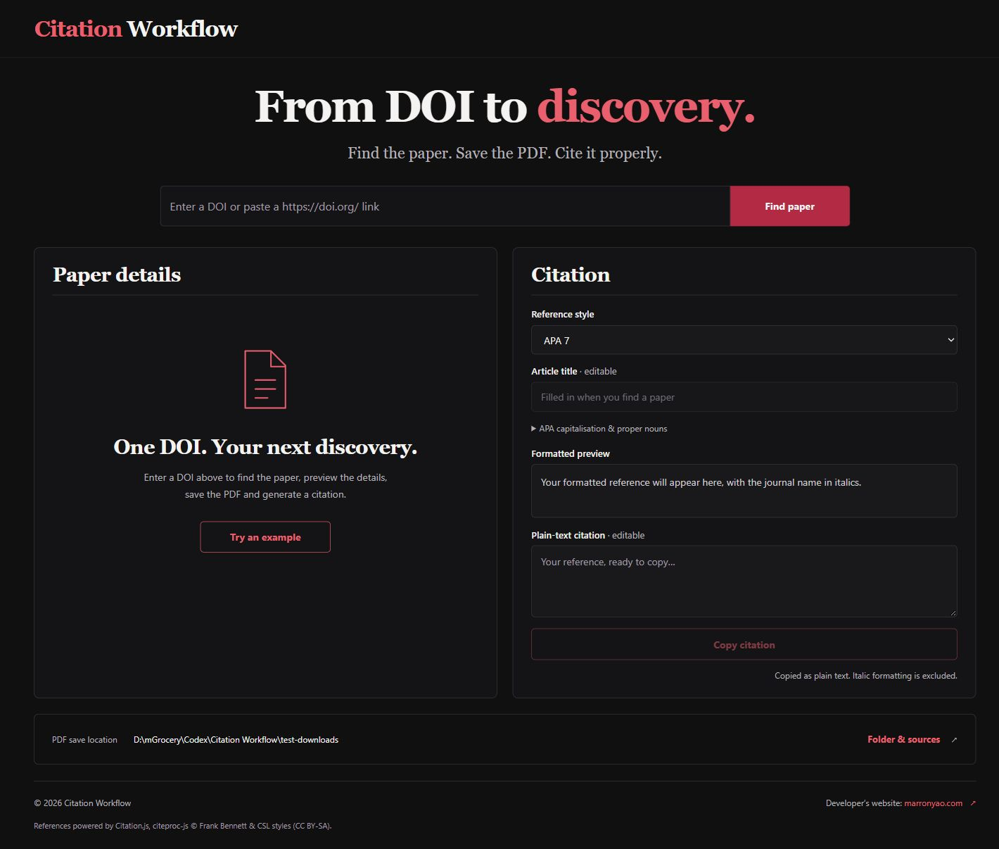

# Citation Workflow

Find a paper by DOI, preprint ID or repository link, save its PDF and generate a reference — in one workspace.

Citation Workflow is a research tool for biological literature, with a dark interface, direct full-text source search and editable references. The website runs on GitHub Pages; a small Windows companion handles full-text retrieval and saves PDFs to your chosen folder.

**[Open Citation Workflow](https://marronyao.github.io/Citation_Workflow/)** · **[Developer’s website](https://marronyao.com/)**



## Features

- Accepts DOIs, versioned arXiv IDs, original preprint links, and individual NeurIPS/PMLR/CVF/ACL conference-paper pages.
- Uses Crossref, DataCite and original repository metadata for references. **PubMed is not queried.**
- Searches for a free full-text PDF when you select Find paper, even when automatic saving is turned off.
- Routes to suitable original preprint/conference repositories, PMC, Sci-Hub, ResearchGate, Z-Library, Library Genesis and Anna’s Archive. Mirror candidates are discovered automatically; availability and verification failures are recorded.
- Supports journal articles, conference papers and preprints, preserving proceedings titles and explicit preprint versions. Offers official publisher/repository links only after automatic source retrieval fails.
- Saves verified PDFs using the original article title, replacing unsupported Windows filename characters. Duplicate downloads receive a numeric suffix rather than overwriting an existing file.
- Generates **APA 7, Vancouver, Harvard, BibTeX, RIS and custom** references.
- Applies APA sentence case to article titles and title case to journal names, with editable titles and a list of proper nouns to preserve.
- Provides an editable plain-text citation and copies it directly.
- Uses British English throughout the interface.

## Getting started on Windows

### 1. Download the project

Choose **Code → Download ZIP** on this repository and extract the archive, or clone it:

```powershell
git clone https://github.com/marronyao/Citation_Workflow.git
cd Citation_Workflow
```

### 2. Start the companion

Install **Python 3.10 or later**, with Python available on your PATH. Chrome or Edge is recommended. No third-party Python packages or Node.js installation are needed to use the tool.

Double-click **`start.bat`**. Keep the companion’s command window open while using the website. A local copy opens at **http://127.0.0.1:8765/**; you can also use the [GitHub Pages website](https://marronyao.github.io/Citation_Workflow/) while the companion is running.

To start it from a terminal:

```powershell
python server.py --origin https://marronyao.github.io --open-browser
```

If your browser asks for permission to connect to the local network, allow it for Citation Workflow. If the hosted page cannot reach the companion, use the local page instead.

### 3. Find and save a paper

1. Select **Set download folder** above the DOI search. Enter an existing Windows folder, or select **Browse folders** to open the native Windows folder picker.
2. Enter a DOI, arXiv ID or supported paper link and select **Find paper**. The tool reads reference metadata and immediately searches suitable full-text sources.
3. Review the paper details and reference. PDFs are saved automatically by default after a source is found; turn this off in settings if you prefer to select **Download PDF** yourself.
4. Choose a reference style, check the title’s capitalisation and select **Copy citation**.

Accepted folder examples:

```text
D:\Papers
D:/Papers
"D:/Research papers"
```

Only absolute Windows drive paths are supported. The folder must already exist; UNC network paths are not currently supported.

## Batch downloads

Select **Batch download** in the top-right corner. Choose a working folder (type its path or use **Browse folders**), select a reference style, and paste one DOI, preprint ID or supported paper link per line. Select **Find papers** to build a results table and search for accessible PDFs. Each row shows its paper type and source-search history. Long titles show their first nine words; hover over a title to see it in full.

Each row provides **Download PDF** and **Copy citation** actions. **Download all PDFs** saves papers sequentially to the selected folder and skips those already saved there during this batch. A failed lookup or download does not stop the remaining papers; failed downloads can be retried or opened through publisher options. Changing the reference style regenerates the row citations. Batch mode does not start downloads until you select a download action.

The folder picker runs through the local companion and requires the standard Python Tkinter component. If it is unavailable, you can still type the folder path. Download progress and results remain on the page while it is open.

## Full-text access

Reference metadata and PDF retrieval are separate. Crossref, DataCite or the original repository supplies the title, authors, paper type and other citation fields. The companion never searches PubMed. PMC is queried directly through its DOI-to-PMC identifier service. PMC PDFs are retrieved from the current public PMC Article Datasets cloud service using DOI-matched version metadata. Deposited article versions are preferred over author manuscripts, which are labelled. The retired OA Web Service is not used.

The source plan prioritises the original repository for a preprint or a conference paper linked directly. Journal articles try PMC, followed by Sci-Hub, ResearchGate, Z-Library, Library Genesis and Anna’s Archive. Conference proceedings are routed to relevant NeurIPS, PMLR, CVF or ACL repositories when identifiable. Recent source successes affect subsequent source order; recent connection or verification failures are temporarily cooled down and reported rather than retried continuously.

Sci-Hub, Z-Library, Library Genesis and Anna’s Archive mirror candidates are discovered through Google/DuckDuckGo search, a Bing structured-search fallback and isolated Chrome/Edge rendering. Domain-pattern filtering rejects obvious lookalike suffixes and local-network URLs; it does not certify a mirror’s ownership or guarantee that it works. No manual mirror address, account creation or credentials are required by this tool. Login-only content, CAPTCHA, author-copy requests and JavaScript challenges may prevent automatic retrieval. The companion does not solve these challenges or send requests to authors.

If no PDF is retrieved, a dialogue offers official links from the DOI/repository metadata and a Google search link. This handles publishers such as Nature, Cell Press, Elsevier, Wiley, ACS, RSC, Springer, IEEE and ACM through their article metadata, without treating publisher sites as automatic fallbacks. A source failure means retrieval failed, not that the paper definitely has no free copy.

Searches have per-source and overall time limits. Found PDFs are checked for a PDF header and temporarily cached locally with a 30-minute entry expiry and a 512 MB total cache limit (expired files are removed on subsequent cache access or when the companion exits), so a later save can reuse the retrieved file. Larger batches may evict earlier files, which are searched again when needed. Copies are saved to the chosen Windows folder only after a download action, or when automatic saving is enabled. Individual downloads remain limited to 80 MB.

## Conference papers and preprints

Supported inputs include:

```text
10.1145/3292500.3330691
arxiv:1706.03762v1
https://arxiv.org/abs/1706.03762v1
https://proceedings.mlr.press/v70/haarnoja17a.html
https://www.biorxiv.org/content/10.1101/2020.01.21.914929v1
10.26434/chemrxiv-2025-5qsh2
```

Conference DOIs retain the `paper-conference` citation type, proceedings title and event metadata when supplied. Individual NeurIPS/PMLR/CVF/ACL pages can also supply conference metadata and PDFs without a DOI. Use a paper page, not an entire volume or conference index.

arXiv IDs and article links, bioRxiv/medRxiv DOIs or versioned links, and ChemRxiv DOIs or supported article links are accepted. Unversioned arXiv and bioRxiv/medRxiv inputs resolve to the current version; explicit versions are preserved. Preprint citations are labelled and do not silently switch to the later journal article. BibTeX includes arXiv eprint information; RIS distinguishes conference papers (`CPAPER`), preprints (`UNPB`) and journal articles (`JOUR`). Repository access restrictions can still prevent PDF retrieval, including on preprint platforms.

## Reference formatting

APA 7, Vancouver and Harvard are rendered using Citation.js and citeproc-js. BibTeX and RIS support reference-manager workflows.

APA article titles use sentence case, preserving abbreviations and mixed-case terms such as DNA and mRNA. Automatic case conversion cannot reliably identify every person, place, species or gene name. Add terms under **APA capitalisation & proper nouns**, or edit the title directly. Titles supplied entirely in capitals need particular care.

**Copy citation** copies plain text. Editing the plain-text box changes what is copied; changing the style or article title regenerates its contents. Paper titles and other bibliographic metadata remain in their original language.

### Custom styles from an example

Select **Custom · from an example** in either single-paper or batch mode, then paste one complete journal-article reference. Detection starts automatically after you stop typing. Including the example’s DOI gives the most reliable match; otherwise the companion searches Crossref and requires one unambiguous title match.

The detected template preserves field order, punctuation, author-name convention, visible “et al.” usage, year placement, page-range style and full or abbreviated journal names. The same custom template is shared between single and batch mode and saved in this browser. An incomplete or ambiguous example disables custom citation copying until it can be identified, rather than reusing an earlier format.

Journal abbreviations are taken from the available DOI registration metadata; no PubMed lookup is made. A dotted example produces dotted abbreviations; an undotted example preserves the undotted form. If no verified abbreviation is available for a target paper, the full journal name is used with a visible note. Abbreviations are never created by arbitrarily shortening a new journal name.

One plain-text example cannot reveal hidden journal rules such as an author limit not exercised in the example, typography, or every special article type. Review the generated text against the journal’s instructions. The example and saved template stay in browser storage; the example is sent to the local companion and, when no DOI is supplied, to Crossref for bibliographic identification. No AI API key is needed.

## How the website and companion work together

```text
GitHub Pages / local webpage
          │
          │ DOI lookup and download requests
          ▼
Windows companion at 127.0.0.1:8765
          ├── DOI / conference / preprint metadata
          ├── Full-text and PDF sources
          └── Your selected Windows folder
```

GitHub Pages hosts the static interface and cannot run the Python companion or write directly to a Windows folder. The companion must run on the computer where PDFs will be saved.

The companion listens only on the loopback interface. It accepts its local origin and, when started with the command above, `https://marronyao.github.io`. API requests that initiate lookups or downloads require a random session token. The local server exposes only the frontend assets, rather than arbitrary local files.

Folder and automatic-download preferences are stored in the browser’s local storage. Folder paths are sent to the local companion for saving; the configured folder is not sent to publication metadata or full-text services. Identifiers, paper titles and download requests are sent to the relevant metadata, repository and search services. Temporary full-text cache files stay on this computer.

## Development

Use Node.js 22 or later and Python 3.10 or later on Windows:

```powershell
npm ci
npm run build
npm test
```

The bundled citation engine is committed so the application works without installing Node.js. Rebuild it after changing `citation-entry.js` or its dependencies.

| File | Purpose |
| --- | --- |
| `index.html`, `styles.css`, `app.js`, `custom-style.js` | Static interface and custom reference inference |
| `server.py`, `paper_metadata.py`, `fulltext_sources.py`, `start.bat` | Windows companion, metadata, source routing and launcher |
| `citation-entry.js`, `vendor/citation.js` | Citation engine entry point and browser bundle |
| `tests/` | DOI, path, download and formatting checks |
| `.github/workflows/pages.yml` | Checks and GitHub Pages deployment |

The deployment workflow checks the project on Windows and publishes only frontend assets and dependency notices to Pages. It excludes downloaded papers, local settings, Python source and development files from the website artifact. The project source remains available in this public repository.

## Sources and acknowledgements

- [PMC ID Converter](https://pmc.ncbi.nlm.nih.gov/tools/id-converter-api/) and [PMC Article Datasets cloud service](https://pmc.ncbi.nlm.nih.gov/tools/pmcaws/) for direct PMC access.
- [Crossref](https://www.crossref.org/documentation/retrieve-metadata/rest-api/), [DataCite](https://support.datacite.org/docs/rest-api), [arXiv](https://info.arxiv.org/help/api/user-manual.html) and [bioRxiv/medRxiv](https://api.biorxiv.org/) for registration and repository metadata.
- [DOI content negotiation](https://www.crossref.org/documentation/retrieve-metadata/content-negotiation/) for bibliographic metadata.
- [Citation.js](https://citation.js.org/), [citeproc-js by Frank Bennett](https://github.com/Juris-M/citeproc-js) and [Citation Style Language styles](https://github.com/citation-style-language/styles) for reference rendering.

Original project code is available under the [MIT licence](LICENSE). Third-party components retain their own licences. See [THIRD_PARTY_NOTICES.md](THIRD_PARTY_NOTICES.md) and [vendor/licenses](vendor/licenses) for attribution and licence information.

© 2026 Citation Workflow · Developed by [Marron Zihao Yao](https://marronyao.com/)
